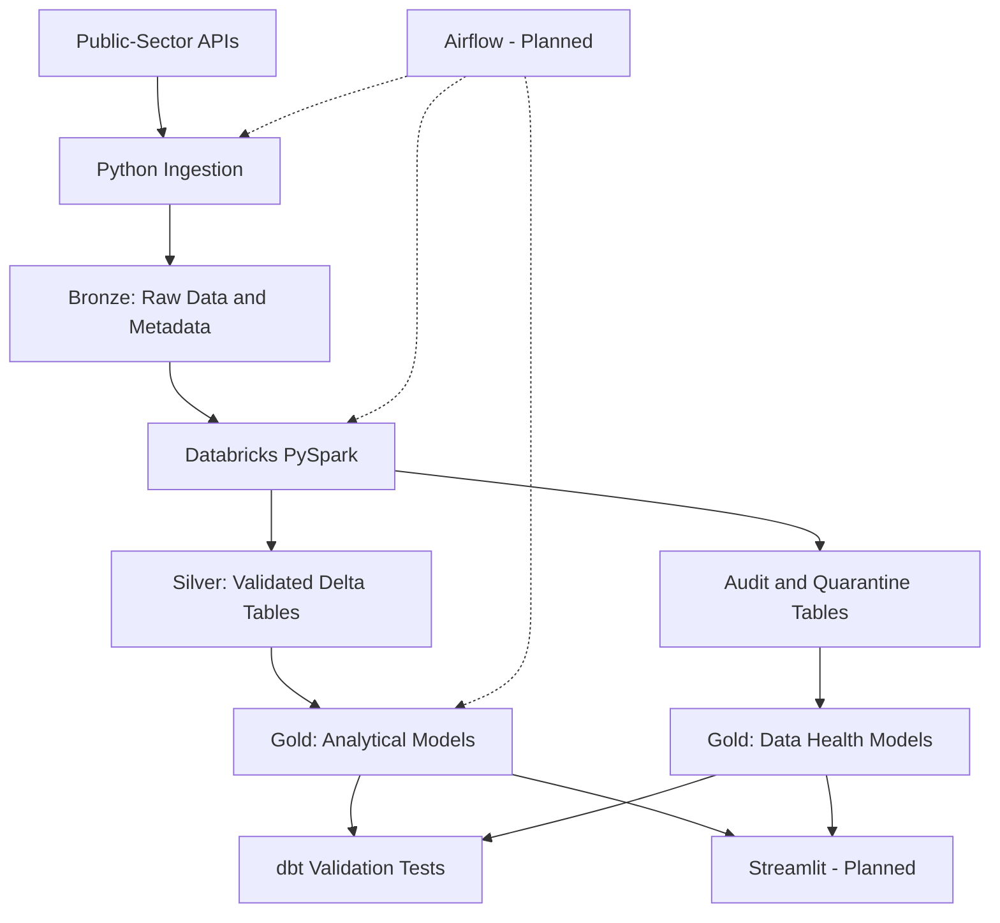

# TrustFlow - Unified Data Intelligence

**From raw government data to reliable, decision-ready intelligence.**

TrustFlow is an end-to-end data engineering portfolio project designed to ingest, process, validate, and analyze data from five public-sector APIs.

The platform follows a **Bronze → Silver → Gold lakehouse architecture**, combining incremental ingestion, distributed data processing, analytical modeling, data quality testing, reconciliation, and pipeline observability.

The goal is to build a reliable, extensible data intelligence platform with analytics and data-health monitoring through Streamlit.

## Project Objectives

- Integrate five real-world public-sector APIs.
- Preserve raw data and ingestion metadata.
- Support historical ingestion and incremental updates.
- Process records with PySpark and Delta Lake.
- Build analytical models using dbt.
- Validate data quality and reconcile processing counts.
- Monitor batch execution, quality, and freshness.
- Develop interactive Streamlit dashboards.
- Automate workflows using Apache Airflow.
- Maintain reproducible, well-tested, version-controlled pipelines.

## Data Sources

| Source | Data | Implementation Status |
|---|---|---|
| NYC Open Data | 311 Service Requests | Bronze, Silver, Gold completed |
| USGS | Earthquake Data | Planned |
| FRED | Economic Indicators | Planned |
| EIA | Electricity Data | Planned |
| NWS | Weather Data | Planned |

**Current focus:** NYC 311, the first end-to-end source implementation.

All five source pipelines remain part of the final TrustFlow scope.

## Technology Stack

| Technology | Purpose |
|---|---|
| Python | API ingestion and data processing |
| JSON / Parquet | Raw data storage formats |
| Databricks | Lakehouse execution environment |
| PySpark | Silver data transformations |
| Delta Lake | Reliable tables and MERGE operations |
| dbt Core | Gold modeling and SQL validation |
| Databricks SQL | Data querying and analysis |
| Apache Airflow | Pipeline orchestration — planned |
| pytest | Python unit tests — planned |
| Docker | Local reproducibility — planned |
| Streamlit | Analytics and health dashboards — planned |
| GitHub | Version control |
| GitHub Actions | CI/CD automation — planned |

The project targets **zero mandatory infrastructure spending**, using available free development services where feasible.

## Architecture



### Bronze Layer

Preserves source data and ingestion metadata.

### Silver Layer

Performs validation, deduplication, quarantine handling, and incremental record updates.

### Gold Layer

Produces business-ready analytical tables and operational data-health metrics.

### Monitoring and Visualization

dbt tests verify analytical and processing consistency. Streamlit and Airflow will provide dashboard visibility and automated execution when implemented.

## NYC 311 Implementation

### 1. Python Ingestion and Bronze

The ingestion pipeline retrieves service requests from NYC Open Data.

Implemented capabilities:

- Date-bounded historical ingestion.
- API pagination.
- Rolling 14-day creation-date refresh.
- Source batch metadata.
- Raw JSON preservation.
- Databricks Volume uploads.
- Remote SHA256 verification.
- Metadata-last upload behavior.

**Main files:**

```text
src/ingestion/nyc_311.py
src/ingestion/nyc_311_refresh.py
src/common/databricks_bronze_uploader.py
```

**Bronze location:**

```text
/Volumes/workspace/default/trustflow_bronze/nyc_311/
```

### 2. PySpark and Delta Lake Silver

Silver processing validates incoming records, quarantines rejected records, and maintains the current validated complaint dataset.

**Main notebook:**

```text
databricks/trustflow_nyc311_silver_v2.ipynb
```

**Silver table:**

```text
workspace.trustflow_silver.nyc_311_requests_v2
```

**Quality tables:**

```text
workspace.trustflow_quality.nyc_311_batch_audit_v2
workspace.trustflow_quality.nyc_311_refresh_audit_v2
workspace.trustflow_quality.nyc_311_quarantine_v2
```

Implemented capabilities include:

- Record validation.
- Duplicate-key handling.
- Invalid-record quarantine.
- Historical batch processing.
- Incremental Delta MERGE operations.
- Processing audit records.
- Preview/apply execution safeguards.
- Source-count reconciliation.

### NYC 311 Processing Snapshot

**November 3, 2026 refresh:**

| Metric | Value |
|---|---:|
| Observed source records | 140,660 |
| Valid records | 140,528 |
| Quarantined records | 132 |
| Planned inserts | 55 |
| Planned updates | 3,015 |
| Planned skips | 137,458 |

These values represent a demonstrated processing snapshot, not live pipeline metrics. Planned MERGE actions should not be interpreted as independently verified committed actions.

## Gold Analytical Models

Six analytical models are implemented using dbt.

| Model | Purpose |
|---|---|
| `daily_complaints` | Daily complaint volume and status distribution |
| `borough_metrics` | Complaint volume across boroughs |
| `complaint_type_metrics` | Distribution across complaint categories |
| `agency_performance` | Agency workload and request status |
| `resolution_time_metrics` | Average, median, and p90 closure durations |
| `borough_complaint_trends` | Daily borough trends and percentage changes |

**Location:**

```text
dbt/trustflow_gold/models/nyc_311/
```

**Databricks Gold schema:**

```text
workspace.trustflow_gold
```

The analytical models summarize current-state Silver records. Daily counts are based on complaint creation dates; they do not represent a complete historical timeline of every status change.

## Gold Data Health Models

Three data-health models monitor the recorded NYC 311 processing pipeline.

| Model | Purpose |
|---|---|
| `nyc_311_batch_health` | Batch execution history, record counts, statuses, and timing |
| `nyc_311_quality_health` | Validation rates, quarantine percentages, and reconciliation |
| `nyc_311_freshness_health` | Latest successful refresh and processing freshness |

**Location:**

```text
dbt/trustflow_gold/models/nyc_311/health/
```

### Batch Health

Combines historical and refresh audit records into a standardized processing-history table.

### Quality Health

Calculates validation percentages and checks whether source, valid, and quarantined record counts reconcile.

### Freshness Health

Identifies the latest recorded refresh and successful processing event.

The initial freshness threshold is **36 hours** and can be configured through dbt.

**Important:** Freshness is evaluated at model-build time. A successful audit or matching record count does not independently prove that the external API is complete or up to date.

## Data Quality and Testing

The dbt project contains:

- **9 Gold models**
- **32 dbt data tests**
- **3 registered dbt sources**

Validation coverage includes:

- Primary-key uniqueness.
- Required-field checks.
- Status-count reconciliation.
- Silver-to-Gold reconciliation.
- Resolution-time accounting.
- Nonnegative numeric values.
- Daily citywide and borough reconciliation.
- Health batch count reconciliation.
- Quarantine percentage validity.
- Freshness consistency.
- Freshness single-row validation.

The 31-test suite passed in a complete dbt build, and the additional 32nd test passed separately.

### Run dbt Validation

From the dbt project directory:

```bash
cd dbt/trustflow_gold

dbt debug

dbt ls --resource-type model

dbt ls --resource-type source

dbt test
```

Build the Gold models and execute their tests:

```bash
dbt build
```

**Note:** `dbt build` recreates the configured Gold tables. Run it after the intended Silver processing has completed, without concurrent Silver writes.

## Project Structure

```text
Trustflow/
├── README.md
├── PROJECT_CONTEXT.md
├── src/
│   ├── ingestion/
│   │   ├── nyc_311.py
│   │   └── nyc_311_refresh.py
│   └── common/
│       └── databricks_bronze_uploader.py
├── databricks/
│   └── trustflow_nyc311_silver_v2.ipynb
└── dbt/
    └── trustflow_gold/
        ├── dbt_project.yml
        ├── models/
        │   ├── source.yml
        │   └── nyc_311/
        │       ├── daily_complaints.sql
        │       ├── borough_metrics.sql
        │       ├── complaint_type_metrics.sql
        │       ├── agency_performance.sql
        │       ├── resolution_time_metrics.sql
        │       ├── borough_complaint_trends.sql
        │       ├── gold_tests.yml
        │       └── health/
        │           ├── nyc_311_batch_health.sql
        │           ├── nyc_311_quality_health.sql
        │           ├── nyc_311_freshness_health.sql
        │           └── health_tests.yml
        └── tests/
            └── [custom dbt SQL tests]
```

## Current Limitations

### Older Complaint Updates

The current 14-day creation-date refresh can miss updates to complaints created outside that window.

A change-aware refresh or broader reobservation strategy is needed.

### Pipeline Automation

End-to-end Airflow orchestration is not yet implemented.

### Failure Monitoring

Audit tables primarily capture recorded processing. Additional logging and orchestration monitoring are needed for failures before audit creation.

### Streamlit Dashboard

The analytical and health tables exist, but the frontend is not yet implemented.

### Remaining Sources

USGS, FRED, EIA, and NWS pipelines are planned.

### Free-Tier Constraints

The project targets zero mandatory cost, but continuously available production-style orchestration is not guaranteed on free services.

## Roadmap

- [x] NYC 311 Python ingestion
- [x] NYC 311 Bronze storage
- [x] NYC 311 PySpark Silver processing
- [x] Incremental Delta MERGE
- [x] Audit and quarantine tables
- [x] Six analytical Gold models
- [x] Three Data Health Gold models
- [x] 32 individually passing dbt tests
- [ ] Streamlit analytics dashboard
- [ ] Streamlit data-health dashboard
- [ ] Change-aware older-record refresh
- [ ] Airflow orchestration
- [ ] pytest automation
- [ ] Docker configuration
- [ ] GitHub Actions CI/CD
- [ ] USGS pipeline
- [ ] FRED pipeline
- [ ] EIA pipeline
- [ ] NWS pipeline
- [ ] Unified cross-source monitoring

## Development Principles

TrustFlow prioritizes:

1. Correctness before optimization.
2. Preserving source provenance.
3. Safe and repeatable incremental processing.
4. Clear data-quality and reconciliation checks.
5. Observable failures and processing freshness.
6. Honest documentation of implemented functionality.
7. Extensible architecture without unnecessary complexity.

## Project Documentation

For technical implementation details, decisions, current progress, and development handoff instructions, see:

**[PROJECT_CONTEXT.md](PROJECT_CONTEXT.md)**

---

**TrustFlow — Unified Data Intelligence**

*Reliable data begins with reliable engineering.*
